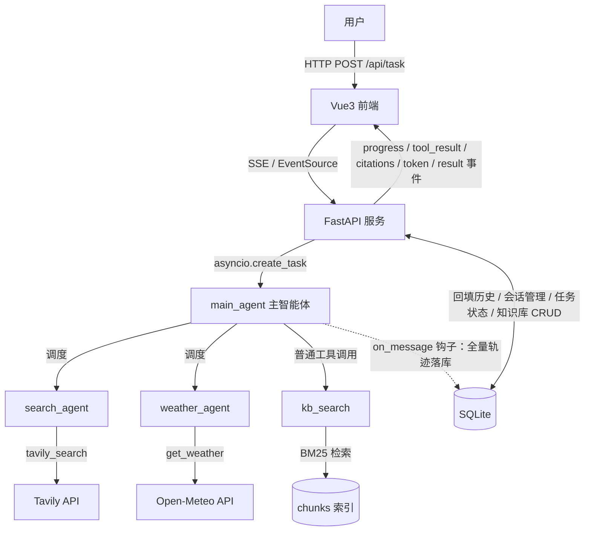

# MultiAgent-Search

从零手搓的多智能体搜索系统：一个主智能体根据用户请求调度联网搜索 / 天气查询两个子智能体，并可通过 `kb_search` 检索本地知识库（RAG），全过程通过 SSE 实时可视化。

不依赖 LangChain / LangGraph 等编排框架——agent 循环、工具调用、多智能体调度、RAG 检索、进度推送全部手写实现，用于深入理解 agent 系统的底层机制。

## 功能

- **多智能体调度**：主智能体分析请求，决定调度哪个子智能体（可并发多个），汇总结果作答
  - `search_agent`：联网搜索（Tavily API，时事查询走新闻索引并按天数过滤）
  - `weather_agent`：天气查询（Open-Meteo API，无需 key）
- **知识库 RAG**：上传 `.txt` / `.md` 或粘贴文本，切块入库后用 BM25 检索，命中片段带引用回显
  - `kb_search` 是**主智能体的普通工具**，不是子智能体——检索是确定性调用，不需要模型内部多轮决策
  - 零依赖 BM25 实现（纯 Python），索引常驻内存、文档变更后懒重建
  - 中文 2-gram + 英文分词，**标题参与索引**（正文是代码时唯一的中文线索）
- **移动端适配**：响应式布局，`≤768px` 时侧边栏变抽屉、聊天区全屏，适配刘海屏安全区与 iOS 键盘
- **会话持久化**：会话与消息落盘 SQLite（SQLAlchemy 2.0 async + aiosqlite）。存储侧保留**全量轨迹**（assistant 中间轮 / tool 调用结果 / 最终回答，逐条增量落库），回填侧只喂**文本轮**（用户提问 + 最终回答），工具噪音不进上下文
- **多轮对话**：主智能体带上下文理解追问（"那上海呢？"），历史跨服务重启、页面刷新均可恢复；子智能体保持无状态、拿到的 query 永远自包含
- **多会话管理**：侧边栏列表 / 新建 / 切换；页面加载与断线重连后自动拉历史对齐，当前会话记在 localStorage
- **任务状态追踪**：每次提交在 `tasks` 表留档（`running → done / error / interrupted`，含错误原因与耗时）；进程重启时残留任务自动标记中断；前端"思考中"判定基于任务状态而非猜测
- **时效性搜索**：两个智能体的 prompt 注入当天日期；时事类查询走 Tavily 新闻索引（`topic=news` + `days` 过滤），结果携带 `published_date`
- **评测集**：断言调度行为与回答质量，支持单轮/多轮用例，报告存档供版本间 diff
- **自动化测试**：`pytest` 覆盖关键路径（会话 CRUD / 重命名持久化 / 任务状态流转 / 知识库上传检索 / SSE 生成器与队列），GitHub Actions 跑 CI——**测试防回归、评测量质量**，两者分工不同
- **实时过程可视化**：调度决策、工具执行、最终回答通过 SSE 逐条推送（token 级流式），前端日志式呈现、断线自动重连
- **统一循环引擎**：所有智能体复用同一个 tool-calling 循环（`run_tool_loop`），新增子智能体只需一份三元组配置
- **聊天式前端**：Vue3 + TypeScript，Markdown 渲染 + 代码语法高亮

## 架构



一次请求的完整链路：

```
用户提问 → POST /api/task（立即返回 task_id）
        → 后台任务先回填该会话的文本轮历史（不含工具轨迹），拼进主智能体的 messages
        → user 消息与任务记录（running）先落库，随后执行 main_agent 循环（中途崩溃提问不丢）
        → 主智能体 function calling 调度子智能体 / 调用 kb_search
          · 涉及时效信息 → search_agent 联网搜索
          · 涉及库内资料 → kb_search 检索本地知识库（命中则推 citations 事件）
        → 子智能体独立上下文中执行工具、消化结果，只返回摘要
        → 每条消息（assistant 中间轮 / tool 结果 / 最终回答）经 on_message 钩子增量落库
        → 主智能体汇总，SSE 推送 result，任务标记 done / error
前端全程通过 SSE 接收 progress / tool_result / citations / token / result / error 事件
```

## 性能优化实录

系统跑通后发现一次"帮我搜索最近的热门消息"要 **~2 分钟**。通过事件日志定位到三个问题并修复：

| 问题 | 原因 | 修复 | 效果 |
|---|---|---|---|
| 一次提问触发 4 次搜索 | 主智能体无调度预算，模糊请求被穷举成多角度搜索 | 主智能体 prompt 增加调度预算（简单问题 ≤1 次、禁止同轮重复调度）与停止条件 | 搜索次数 4 → 1 |
| 子智能体内部反复搜索 | 子智能体循环继承 8 轮上限，无收敛约束 | 子智能体 prompt 硬性规定"只调用一次 tavily_search" | 单次子智能体调用耗时砍半 |
| 同轮多个工具调用串行执行 | 循环内逐个 `await` | 同轮无依赖的调用改为 `asyncio.gather` 并发；返回 `(tool_call, result)` 配对、按声明顺序回填 | 两桩各 1s 的工具：2.0s → 1.0s |

**结果：单次查询端到端延迟 ~2 分钟 → ~2 秒（约 98% 降低）**，且未改动任何核心逻辑——全部收益来自调度策略（prompt 约束）与并发化。

并发改造的两个细节：

- **配对而非依赖顺序**：`run_tool` 返回 `(tool_call, result)`，回填与落库按声明顺序串行执行——并发只发生在"纯 IO 的工具执行"段，避开 SQLite 并发写，也保证 `tool` 消息顺序与 `tool_calls` 声明一致
- **可测性**：mock 掉 LLM 调用、用两个各耗 1 秒的桩工具直接跑 `run_tool_loop`——并发 1.0s / 串行 2.0s，一行数字验证并发生效

## 并发限流笔记

同轮工具并发落地后，下一个问题是"并发的上限"。以下是推演结论（当前 prompt 已把同轮调度限到 ≤2，尚未在代码中启用）：

- **作用域决定语义**：`Semaphore` 定义在 `run_tool_loop` 内部 = 每个 agent 循环各自限流、互不影响；定义在模块级 = 全局共享
- **编排层放全局锁是死锁配方**：子 agent 是被主 agent 通过工具调用拉起的，父子两层会申请同一个池——"占着名额等名额"（父任务占满名额等子任务完成，而子任务等名额才能开始）会让工具调用全系统卡死
- **"数安全名额"是魔数**：父子两层占用、多会话并存、调度数量放开……推算出来的安全值会被结构演化推翻
- **正确位置是"申请链的末端"**：限流应放在叶子出口（如 `tavily_search` 内部、LLM 调用处）——那里没有嵌套申请，参数语义是"同时在飞的外部请求数"，与编排结构无关

## 会话持久化设计

表结构见 `docs/init.sql`（开发期手动建表，SQL 与 ORM 定义双处对齐）。几个核心决策：

- **存全量、喂精简**：存储侧保留完整事件流——`user` 提问、`assistant` 中间轮（带 `tool_calls`）、`tool` 结果、最终回答，逐条增量落库；回填 LLM 只取**文本轮**（`role IN (user, assistant)`、`tool_calls IS NULL`、`content != ''`）。调试时可完整回放，上下文里没有工具噪音
- **事件流模型**：一条消息一行（不是一问一答一行），`tool_call_id` 负责配对"调用声明 ↔ 调用结果"；一次询问落库行数 = 1 (user) + R (assistant 行) + T (tool 行)
- **增量落库**：`on_message` 钩子在每条消息产生的瞬间写库，而非跑完一次性写入——中途崩溃保留现场，运行状态可实时查询

## 知识库 RAG

上传文档 → 切块 → 入库 → 检索。检索器对外只有一个 `Retriever` Protocol（`search(query, top_k)`），当前实现是零依赖的 BM25，v2 换 embedding 不影响调用方。

### 为什么 RAG 是工具而不是子智能体

判断标准只有一条：**这个子任务内部需不需要模型自己做多轮决策？**

| | 内部要决策吗 | 结论 |
|---|---|---|
| `search_agent` | 要（选词 → 判断够不够 → 换切口重试 → 按格式输出） | 独立循环 ✅ |
| `weather_agent` | 不要（一次 API + 格式化） | 严格说也不需要 |
| **`kb_search`** | **不要**（`query → top_k`，纯确定性调用） | **做成普通工具** |

三条具体理由：

1. **信息损耗**：子 agent 拿到 5 条 chunk 要先读一遍、再总结一遍，主 agent 再总结一遍——三次总结，而 RAG 要的恰恰是**原文照搬**
2. **信号量死锁风险**：`loop.py` 的 `tool_semaphore` 是模块级全局的，子 agent 嵌套会多占一个名额
3. **进度不可见**：子 agent 不透传 `on_progress`，内部轮次前端看不到；做成工具则 `kb_search` 直接出现在 SSE `progress` 里

**升级路径是无痛的**：工具名和 schema 都不变，只把 `tool_map["kb_search"]` 从函数换成 `run_kb_agent`，主 prompt 和前端零改动。何时才该升级：需要 query 改写 / 多跳检索、rerank + 多路召回融合、或要塞几十个片段只回传结论。

### 切分与检索

- **切分**（`chunker.py`）：按行聚合成 ~500 字的块，相邻块保留 50 字重叠——防止答案正好卡在切割线上
- **分词**（`retriever.py`）：英文按单词、中文 2-gram，纯正则无依赖
- **索引**：`tokens = tokenize(title) * 3 + tokenize(content)`，标题重复计入 3 份做温和加权
- **懒重建**：`mark_dirty()` 只打标记，下次 `search` 才重建；进程重启后首次检索自动重建

### 踩过的坑：只索引 content 导致"搜标题搜不到"

知识库里明明有《LRU 缓存 双链表写法》，搜"缓存"/"双链表"/"LRU" 却**全部 0 命中**，agent 于是回答"知识库里没有这部分内容"——**它在说假话，知识库其实有**。

根因：`_rebuild()` 里 `tokens = tokenize(content)`，`Document.title` 虽然 SELECT 出来了但只用于展示，**从没进过索引**。而该文档正文是**纯 C++ 代码**，一个中文字都没有，中文信息全在标题里。

修复后：

| 查询 | 修复前 | 修复后 |
|---|---|---|
| `缓存` | 0 条 | 3 条，top《LRU 缓存 双链表写法》3.0754 |
| `双链表` | 0 条 | 3 条，top 同上 6.1508 |
| `今天晚饭吃什么` | 0 条 | 0 条（回归正确） |

> 习惯：**只要正文可能是代码/英文，就必须把标题纳入索引**；检索类功能一定要用"已知存在于库中的内容"做召回测试。详见本地 `docs/problem.md`（踩坑记录，未入库）。

### 空结果必须显式告知

`kb_search` 无命中时返回 `{"results": [], "note": "知识库没有命中相关片段，可以改用 search_agent 联网搜索"}`——只返回空列表时模型很容易自己编，这是 RAG 最常见的幻觉来源。

## 移动端适配

`≤768px` 时切换为移动布局，桌面端交互完全不受影响。

**核心问题：`index.html` 缺 viewport meta**。没有它，手机浏览器按 980px 虚拟宽度渲染再整体缩小，导致响应式断点永远不生效、字体被缩得很小。

```html
<meta name="viewport" content="width=device-width, initial-scale=1.0, viewport-fit=cover" />
```

**布局方案：三段式固定**

不用 `position: fixed`（会和 iOS 键盘打架），而是让 flex 容器吃满高度，中间消息区独占剩余空间并自己滚动——header 和输入框天然不动。

```css
.app-shell { height: 100vh; height: 100dvh; }   /* dvh 跟随地址栏收放 */

@media (max-width: 768px) {
  .app-body    { height: 100%; overflow: hidden; }
  .app-header  { padding-top: env(safe-area-inset-top); }      /* 刘海 */
  .message-list{ overflow-y: auto; overscroll-behavior: contain; }
  .input-bar   { margin-bottom: calc(12px + env(safe-area-inset-bottom)); }  /* 底部横条 */
  .chat-input  { font-size: 16px; }   /* < 16px 时 iOS 会自动放大页面 */
}
```

**侧边栏改抽屉**：`position: fixed` + `transform: translateX(-100%)`，宽度 `82vw`（上限 300px），配遮罩，点会话项自动收起。

**触摸交互的三个坑**

| 现象 | 原因 | 修复 |
|---|---|---|
| 点击时闪一下背景色 | 浏览器默认 tap highlight | `-webkit-tap-highlight-color: transparent` |
| 点完背景色不恢复 | 手机上 `:hover` 会"粘住" | 用 `@media (hover: hover)` 限定悬停样式 |
| **三点菜单在手机上永久不可见** | `opacity: 0` 只在 `:hover` 时显示，触摸设备没有 hover | `@media (hover: none)` 下改为常驻 `opacity: 0.55` |

最后一条是隐藏的功能缺陷：手机上根本没法重命名/删除会话。关掉 tap highlight 后必须用 `:active` 自己补按下反馈，否则点击毫无视觉响应。

**手机访问**：Vite 配置 `host: '0.0.0.0'`，同一 WiFi 下手机浏览器打开 `http://<电脑局域网IP>:5173` 即可（前端全用 `/api` 相对路径，走代理无跨域问题）。

## 任务状态与崩溃恢复
每次提交在 `tasks` 表留一条执行记录：`running` → `done` / `error`（附错误原因与耗时）；进程被杀来不及收尾的任务，由下次启动批量标记为 `interrupted`（启动善后）。前端重连后按任务状态（而非聊天记录）恢复"思考中"判定，中断的任务会显示提示条。任务记录只随会话删除级联清理。

## 流式推送迁移实录（WebSocket → SSE）

推送是纯单向流（进度 / token / 结果），而客户端上行全是普通 HTTP——WebSocket 的双向通道只用了一半。迁移到 SSE 后，`EventSource` 自带断线重连（手写重连逻辑整个删掉），服务端从"连接字典 + accept 循环"简化为"会话队列 + StreamingResponse"。

SSE 的"永不结束的响应"这一特性，在迁移中踩了两个坑：

**坑 1：vite dev 代理攒包**（页面刷新后历史约 20 秒才显示）

- **排查**（逐层探测法）：直连后端响应头 `t+0.59s`；经 vite 代理 `t+15.47s`，且与第一条 keepalive 同刻到达——代理一直攒着响应头，直到第一块数据才转发，而首块数据恰好是 15 秒后的心跳
- **修复**：`generate()` 开头立即 `yield ": connected\n\n"`（SSE 注释行，浏览器忽略），让代理在连接瞬间就 flush 响应头

**坑 2：Ctrl+C 退出卡在 "Waiting for connections to close"**（uvicorn 优雅关闭等不到"永不结束"的流）

- **根因**：uvicorn 关闭流程为"请求所有连接关闭 → 等连接清空 → lifespan 清理"；SSE 连接不会自己结束，而 `timeout_graceful_shutdown` 默认为无限等待——于是卡住，直到二次强制退出（`reload` 模式的重启同样受影响）
- **修复**：`uvicorn.run(..., timeout_graceful_shutdown=3)`——宽限 3 秒后强制取消残留任务，干脆退出

**共性本质**：流式链路的每一层都可能缓冲（浏览器 / dev 代理 / nginx / 网关）——nginx 侧由 `X-Accel-Buffering: no` 响应头防住，dev 代理侧靠"连接即吐一行"防住；而"永不结束的连接"与"优雅关闭"天然矛盾，服务器平滑重启要靠显式超时划边界。

## 工程习惯笔记

重构与测试过程中被真实事故训练出来的四条习惯：

- **跨文件改名/搬家：改完必搜**——Python 无编译期检查，漏改的调用点只会在运行时爆（`AttributeError`）；用 IDE 的 Rename（`Shift+F6`）自动扫全项目，或改完 `grep -rn "旧名"` 一遍
- **提交前"三连"**——`git status`（看清范围，特别留意 `??` 未跟踪文件）；`git diff --cached --stat`（确认暂存区恰好只装当前主题）；分主题提交时用 `git restore --staged` 撤出不属于本主题的改动
- **重构的验证网**——`grep` 残留 → `import` 冒烟 → 静态检查（mypy）→ 端到端跑一条真实链路；四层各自拦截不同级别的错误（引用残留 / 启动失败 / 属性不存在 / 行为回归）
- **测试分层**——单元（生成器 / 队列 / 纯函数，快而稳）→ 集成（`ASGITransport` + 短请求，验 API 契约）→ e2e（真实浏览器 / 进程，验长连接与交互）；"测不了"往往不是写错了，是**这一层不该用这种工具测**

## 评测集

prompt 和调度策略的每次改动都用同一套用例量化，避免"感觉上变好了"。

```bash
cd backend
python -m evals.runner                       # 全量
python -m evals.runner multi_turn_coref_001  # 只跑指定用例（调 prompt 时用）
```

用例写在 `evals/cases.yml`：单轮用例是一问 + expect；多轮用例用 `turns` 数组，历史逐轮累积喂给主智能体（与线上回填策略一致）。expect 支持的断言：

| 字段 | 含义 |
|---|---|
| `subagents` | 本轮应该调度哪些子智能体（精确匹配） |
| `max_tool_calls` | 本轮工具调用次数上限（调度预算） |
| `must_contain` | 回答必须包含的关键词（全部命中） |
| `any_contain` | 回答命中任一即可的关键词 |
| `max_latency_s` | 本轮耗时上限 |

每轮报告存档在 `evals/results/report_*.json`，供不同版本之间 diff 对比。

### 两条实战教训

- **结构全过 ≠ 内容正确**：`tavily_search` 曾因 key 里一个多余空格（`"content "`）把所有正文取成空串，4 个用例照样 4/4 通过——调度、预算、延迟全对，回答却是一封道歉信。结构性断言之外，必须保留 `answer_preview` 人肉复核这一层。
- **对自由生成文本逐字断言必然 flaky**：模型这轮写"温度"、下轮写"气温"，逐字断言今天过明天就挂。断言要锚定稳定产物——实体名、数值单位、来源 URL；措辞类关键词用 `any_contain` 兜底。

## 快速开始

```bash
# 后端（Python 3.10+）
cd backend
python -m venv .venv && .venv/Scripts/activate   # Windows；macOS/Linux 用 source .venv/bin/activate
pip install -r requirements.txt
copy .env.example .env                            # 填入 LLM 与 Tavily 的 key
python -c "import sqlite3; sqlite3.connect('app.db').executescript(open('../docs/init.sql', encoding='utf-8').read())"   # 手动建表（schema 见 docs/init.sql）
python run.py                                     # 服务起在 :8001
pip install -r requirements-dev.txt               # 测试依赖（pytest / pytest-asyncio）
python -m pytest                                  # 跑测试（独立 test.db，不碰 app.db）

# 前端（Node 18+）
cd frontend
npm install
npm run dev                                       # 页面起在 :5173，/api 已代理到后端
```

需要配置的环境变量（见 `backend/.env.example`）：

| 变量 | 说明 |
|---|---|
| `LLM_API_KEY` / `LLM_BASE_URL` / `LLM_MODEL` | 任意 OpenAI 兼容模型（DeepSeek / 通义均实测可用） |
| `TAVILY_API_KEY` | 联网搜索用，[tavily.com](https://tavily.com) 免费档每月 1000 次 |
| `DB_URL` | SQLite 连接串，默认 `sqlite+aiosqlite:///./app.db`（相对 backend 启动目录） |

### 手机访问（同一局域网）

Vite 已配置 `host: '0.0.0.0'`，手机连同一个 WiFi 后直接访问：

```
http://<电脑局域网IP>:5173
```

查当前 IP：

```powershell
Get-NetIPAddress -AddressFamily IPv4 | Where-Object { $_.InterfaceAlias -eq 'WLAN' }
```

> 注意：`crypto.randomUUID()` 只在安全上下文（HTTPS / localhost）可用，普通 HTTP 下为 `undefined`。项目已用 `shortId()` 做三级降级（`randomUUID` → `getRandomValues` → `Math.random`），否则手机上会白屏。

### 使用知识库

1. 点侧边栏「📚 知识库」打开抽屉
2. 上传 `.txt` / `.md`（≤5MB，UTF-8）或粘贴文本
3. 点文档可展开查看切分结果，也可用「检索调试」直接看 BM25 命中排序
4. 回到聊天，问库内相关内容即可——主智能体会自动调 `kb_search`，回答下方可展开「参考片段」

> 首先生效需要索引重建：上传/删除后会自动标记脏，下次检索时重建，无需手动操作。

## API 一览

完整的请求/响应结构、字段类型、错误码、SSE 事件字段表见本地 `docs/api-contract.md`（接口契约，未入库）。

| 方法 | 路径 | 说明 |
|---|---|---|
| `POST` | `/api/task` | 提交提问（`query` + `session_id`），立即返回 `task_id`，结果经 SSE 推送 |
| `GET` | `/api/events/{session_id}` | SSE 事件流：`progress` / `tool_result` / `citations` / `token` / `result` / `error` |
| `GET` | `/api/session` | 会话列表（最近活跃在前，含标题） |
| `GET` | `/api/session/{id}/messages` | 指定会话的展示用历史（文本轮、正序） |
| `GET` | `/api/session/{id}/tasks` | 会话的任务记录（状态 / 错误 / 耗时） |
| `PATCH` | `/api/session/{id}` | 重命名会话 |
| `DELETE` | `/api/session/{id}` | 删除会话（消息级联清理） |
| `POST` | `/api/kb/documents` | 上传文档（multipart：`file` 或 `content` + `title`，≤5MB UTF-8） |
| `GET` | `/api/kb/documents` | 文档列表（含 `chunk_count`） |
| `GET` | `/api/kb/documents/{id}` | 文档详情（含全部分块内容） |
| `DELETE` | `/api/kb/documents/{id}` | 删除文档（分块级联清理） |
| `POST` | `/api/kb/search` | 检索调试（不经过 agent，直接看 BM25 命中排序） |
| `GET` | `/health` | 健康检查（**不在 `/api` 前缀下**） |

> ⚠️ 两个易错点：`/kb/search` 是 **POST + JSON** 不是 GET；上传用 `FormData` 时**不要手动设 `Content-Type`**，否则没有 boundary 会 422。

## 技术栈

- **后端**：Python / FastAPI（SSE 流式推送，StreamingResponse）/ OpenAI 兼容 SDK（异步） / httpx / SQLAlchemy 2.0 async + aiosqlite / python-multipart（文件上传） / PyYAML（评测用例） / pytest + pytest-asyncio（测试）
- **前端**：Vue3（script setup）/ TypeScript / Vite / axios + EventSource / marked + highlight.js + DOMPurify
- **代码分层**：`api`（HTTP 适配：路由与回执）→ `service`（会话 / 任务 / SSE / 知识库业务）→ `db`（模型与引擎）；agent 循环、叶子工具、检索器独立成包
- **CI**：GitHub Actions（push / PR 自动跑 pytest）
- **无 agent 框架依赖**：tool-calling 循环、多智能体编排、上下文隔离、BM25 检索均为手写实现

## 项目结构

```
backend/
  app/
    api/          HTTP 路由：chat（任务+SSE）/ session / kb
    service/      业务层：session / task / sse / kb
    agent/        loop（统一循环引擎）/ main_agent / search_agent / weather_agent
    tools/        叶子工具：tavily_search / weather / kb_search
    kb/           chunker（切分）/ retriever（BM25）
    db/           models / session（引擎与 get_db）
    core/         config（pydantic-settings）
  evals/          评测：runner + cases.yml + results/
  tests/          pytest：conftest（隔离库 / client / mock agent）+ 会话 / 任务 / 知识库 / SSE
frontend/
  src/
    api/          index（axios 实例）/ session / kb
    components/   ChatBubble / KbPanel / ConfirmDialog / PromptDialog / 图标
    types/        types.ts（SSE 事件的联合类型）
    App.vue       主界面：会话管理 + SSE 消费 + 移动端抽屉
docs/
  api-contract.md 前后端接口契约（唯一依据）
  problem.md      踩坑记录
  init.sql        建表 SQL
```

## Roadmap

- [x] 评测集：固化测试用例，量化 prompt 与调度策略改动的影响
- [x] 多轮对话：主智能体带上下文做指代消解
- [x] 流式输出（token 级打字机效果）
- [x] 会话持久化：SQLite 全量轨迹落盘 + 多会话侧边栏（刷新 / 断线重连后回放）
- [x] 任务状态追踪：任务状态落库（含崩溃自动标记），重连后可查"是否有任务在跑"
- [x] **知识库 RAG**：文档上传 / 切分 / BM25 检索 / 引用回显（`kb_search` 工具）
- [x] **移动端适配**：响应式抽屉布局、安全区、触摸交互
- [x] **接口契约文档**：前后端字段级对照 + 时序图
- [x] **自动化测试与 CI**：pytest 覆盖关键路径（独立测试库 + mock LLM），GitHub Actions 自动运行
- [ ] Embedding 检索器（`Retriever` Protocol 已预留，`chunks.embedding` 字段待启用）
- [ ] 知识库升级为 `kb_agent`：query 改写 / 多跳检索 / rerank 融合
- [ ] 中文分词换 `jieba`（当前 2-gram 会产生 `存的`/`的双` 这类噪声 token）
- [ ] 代码执行子智能体（Docker 沙箱）
- [ ] NL2SQL 子智能体
